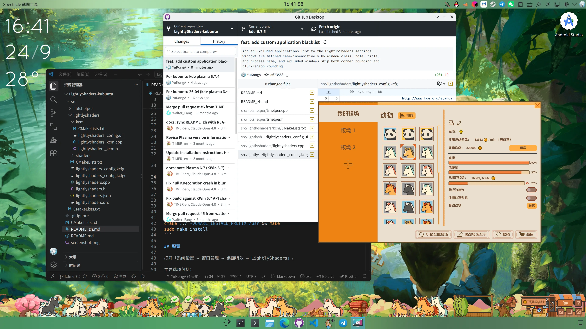

English | [中文](README_zh.md)

# LightlyShaders v3.0

LightlyShaders rounds window corners and adds configurable outlines and shadow handling. It works correctly with the stock Plasma effects and supports KDE Plasma/KWin 6.7 and newer. This Kubuntu branch is tested on Kubuntu 26.04.



## Features

- Rounded or squircle window corners
- Inner and outer outlines with configurable colors and widths
- Configurable shadow offset
- Optional disabling for maximized windows
- Per-application blacklist with selectable matching scope
- Blacklist support for both corner rounding and rounded blur regions

## Dependencies

You need Qt 6, KF6, KWin, KDecoration3, X11, and XCB development packages.

**Kubuntu 26.04 / Ubuntu-based systems**:

```bash
sudo apt update
sudo apt install \
    build-essential cmake extra-cmake-modules gettext git \
    qt6-base-dev qt6-base-private-dev qt6-tools-dev \
    libkf6config-dev libkf6configwidgets-dev libkf6coreaddons-dev \
    libkf6crash-dev libkf6globalaccel-dev libkf6guiaddons-dev \
    libkf6i18n-dev libkf6kcmutils-dev libkf6kio-dev \
    libkf6notifications-dev libkf6service-dev libkf6widgetsaddons-dev \
    libkf6windowsystem-dev kwin-dev libkdecorations3-dev libepoxy-dev \
    libx11-dev libxcb1-dev
```

## Manual installation

```bash
git clone https://github.com/YuKongA/LightlyShaders-kubuntu
cd LightlyShaders-kubuntu; mkdir qt6build; cd qt6build
cmake ../ -DCMAKE_INSTALL_PREFIX=/usr && make
sudo make install
```

## Configuration

Open **System Settings → Window Management → Desktop Effects → LightlyShaders**.

The main options control:

- Corner size and shadow offset
- Inner and outer outlines, including colors and widths
- Whether the effect is disabled for maximized windows
- Rounded or squircle corner shape and the squircle ratio
- Applications excluded from the effect

The separate **Blur (LightlyShaders)** effect provides blur strength and noise settings. Its rounded blur regions share the application blacklist configured in LightlyShaders.

### Application blacklist

Use **Excluded applications** to prevent LightlyShaders from affecting selected applications. Matching is case-insensitive and uses substring matching against:

- Window class
- Window role
- Window title
- Process name and executable name

Each entry can control its own matching scope:

| Entry                 | Matching behavior                                                                                |
| --------------------- | ------------------------------------------------------------------------------------------------ |
| `TinyPasture`         | Matches window information and the process name. This is the default and is backward compatible. |
| `process:TinyPasture` | Matches the process name only, excluding every window created by that process.                   |
| `window:TinyPasture`  | Matches the window class, role, and title only. It does not match the process name.              |
| `steam_app_3167550`   | Matches the window class.                                                                        |

Example for TinyPasture:

- The main window has window class `steam_app_3167550` and title `TinyPasture`.
- The farm window has the same window class but an empty title.
- `TinyPasture` or `process:TinyPasture` excludes both windows.
- `window:TinyPasture` excludes only the main window because the farm window has no matching title.
- `steam_app_3167550` matches both windows through their shared window class.

After saving, both LightlyShaders effects are reconfigured immediately. After installing or upgrading the plugin, log out and back in, or disable and re-enable the effects, so KWin loads the new plugin binary.

## Note

After Plasma/KWin updates, rebuild the plugin so it can follow KWin API changes. If CMake reports missing headers, install the development packages above and rerun the configure command.
